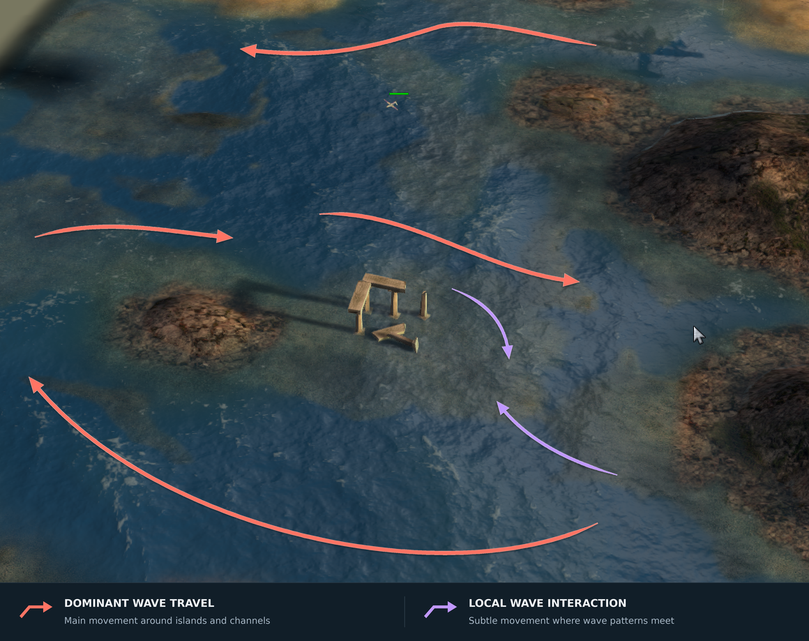
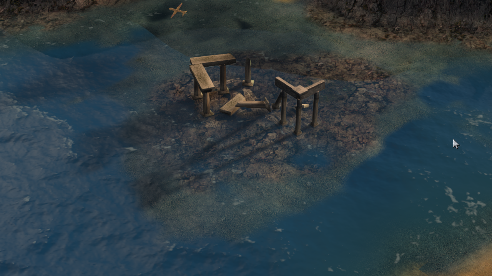
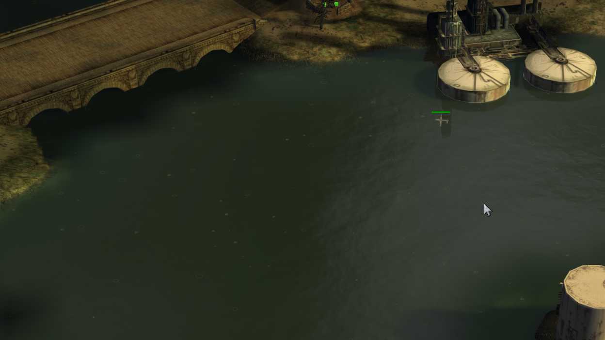
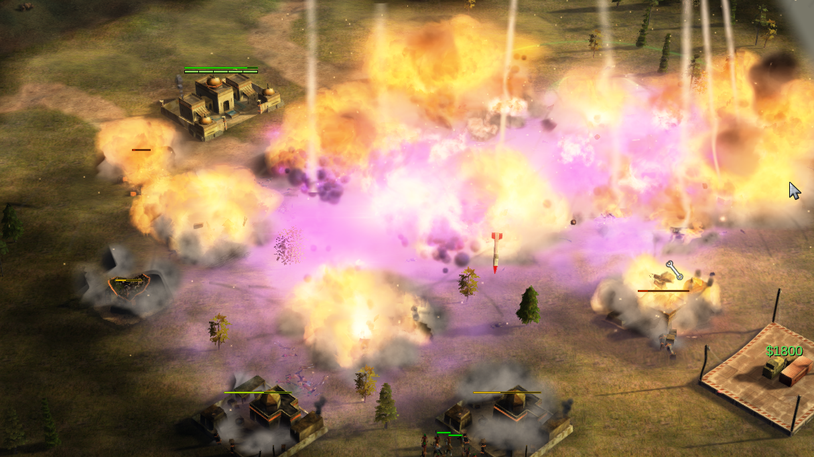
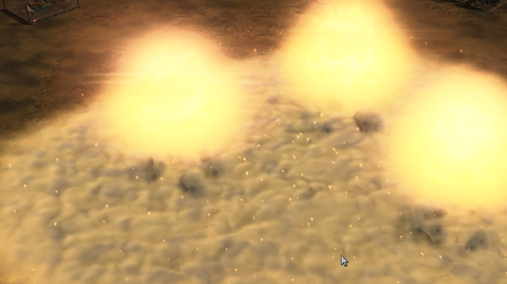
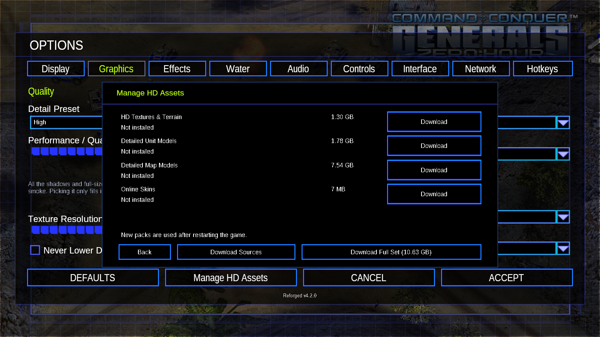

# Zero Hour Reforged Linux

A **Linux-only experimental fork** of [Zero Hour Reforged at zerohour.gg](https://zerohour.gg),
based on its [upstream source](https://github.com/olcayseygan/CnCGeneralsZH-Reforged) and EA's released code.
Generals and Zero Hour run natively on **64-bit Linux with SDL3 and Vulkan**. No Wine or Proton required.

This fork develops and tests new graphical effects on Linux, often before they are offered upstream.
It also brings effects from upstream's Windows Direct3D 11 renderer to Linux and carries campaign fixes.
Some changes are accepted upstream; others remain experimental or specific to this fork.

**Experimental graphics can reduce performance.** Some effects are still being tuned for Zero Hour's
renderer and large battles. Frame rate and memory use depend on the map, GPU, settings and number of
active effects; the newest visuals may cost more than their upstream counterparts. Classic graphics
and individual effect controls let you adjust the balance.

[](https://github.com/Shin-Aska/CnCGeneralsZH-Reforged-Linux/commits/main)
[](LICENSE.md)

[Downloads](#downloads) · [Experimental features](#experimental-features) · [Already upstream](#already-upstream) ·
[Upstream status](docs/upstream-status.md) · [Build](#build) · [Play](#play) · [Linux guide](docs/linux.md)


*Modern water and ship foam in an actual Linux match. The screenshots below are game captures.
Wave-direction arrows follow the maintainer's marked reference.*

**You need your own installed copies of Generals and Zero Hour.** Game data and optional upscaled art
are not included. The features below describe the development branch; packaged releases may contain
an earlier selection. See the [release notes](docs/releases/v4.2.0.md) and [upstream tracker](docs/upstream-status.md).

## Experimental features

These additions are available in this fork and have not been accepted upstream as of **2026-11-16**.
The [upstream-status tracker](docs/upstream-status.md) distinguishes work not yet submitted from
pull requests that were closed without merging, and records the supporting checks.

### Graphics

| Feature | What this fork adds |
|:--|:--|
| **Linux ports of Direct3D 11 effects** | Native SDL3/Vulkan support for effects previously restricted to upstream's Windows renderer: weather and atmosphere, enhanced lighting, particles, post-processing and more. Details below. |
| **Underwater clarity** | Submerged ruins and seabed remain visible on raised shallow shelves, restoring the readable transparency available with Classic water while retaining Modern waves and reflections. Deep water keeps its opacity. |
| **Reworked FFT water** | Reworks the original Modern-water wave pipeline with a shared FFT ocean, a revised wave spectrum, depth-aware wave attenuation, filtered sun glints and wave-driven foam. This newer implementation has not been accepted upstream. |
| **Map-aware water movement** | Wind-driven wave patterns follow channels, bend toward shores and respond to open-sea exposure and shelter. Independent coastal water bodies can have different headings. |
| **Toxic-water materials** | Map water colours and texture names select material rules. Toxic water can be murkier, duller and less responsive to wind, with bubbles retained as its visual indicator. |
| **Path-traced water reflections** | An experimental water-only reflection mode alongside Legacy, SSR and Hybrid. It has a higher rendering cost and approximate scene coverage. |
| **Extended volumetric toxin effects** | Toxin Tractor Contaminate, toxin impacts and attached toxin puddles use volumetric clouds, in addition to the toxin and radiation fields already supported upstream. |
| **Asset Preloading** | Audio files are cached and common renderer pipelines are warmed during loading to prepare for first use. This moves work into loading and can increase load time and memory use. |

The Linux effects port includes:

- **Weather and atmosphere:** rain spells, drifting snow, blowing sand, gusts, matching ambience and haze/sky lighting.
- **Lighting and post-processing:** per-pixel lighting, Firelight, sky/ground lighting, ambient occlusion and internal HDR tone mapping.
- **Particles and distortion:** soft particles, procedural fire, GPU particles, heat haze and blast distortion.
- **Battlefield detail:** model status effects and team glow, defence-range overlays, Battle Marks, Classic-water foam and impact splashes, and building-collapse camera effects.

[Linux effects and validation](docs/linux.md#native-enhancement-validation-2026-11-15) ·
[Weather](docs/linux.md#weather) · [Asset preloading](docs/linux.md#asset-preloading)

### Water that responds to the map

The water shown here uses this fork's reworked FFT implementation of the original Modern-water renderer.
Open water, islands, channels and sheltered basins shape the visible wave pattern. Wind settings drive
the wave spectrum, while the map's water layout guides its travel. Material rules control the liquid's
appearance and response to wind. This is a cosmetic wave model; it does not change unit movement.



*Red: dominant wave travel. Purple: subtler local movement where wave patterns meet. The arrows follow
the maintainer's observations in this match.*

| Clear shallows | Toxic industrial water |
|:--|:--|
|  |  |
| Raised shallows reveal terrain and ruins beneath the surface. | Toxic materials retain bubbles while reducing clarity, glints and wind-wave motion. |

[FFT rework](docs/modern-water-clean-fft-report.md) · [Map-aware movement](docs/linux.md#boundary-aware-water) · [Water settings](docs/linux.md#modern-water-options) ·
[Reflections and live material preview](docs/water-preview.md)

### Clouds across the battlefield

The shared cloud renderer already exists upstream. This fork extends it to Contaminate while spraying
and afterward, brief toxin impacts, and puddles attached to moving or damaged sources. The clouds follow
their sources and actual effect lifetimes; damage and weapon timing stay the same.

| Toxin across a base | Nuclear haze and embers |
|:--|:--|
|  |  |
| Volumetric toxin fields shown during ordinary gameplay. | The nuclear-cloud baseline is shared with upstream. |

[Cloud effects and their limits](docs/hazard-clouds.md) · [Cloud preview](docs/cloud-preview.md)

### Campaign

- **Original USA campaign startup:** fixes a crash in this fork's Linux Modern-water path when starting the first original Generals USA mission and other inland maps.
- **Briefing narration:** restores the configured spoken briefings for the original Generals campaigns, including loading paths where the voice never started.
- **Speech timing:** fixes premature briefing waits and frozen-world countdowns that could cut lines short or make them overlap. Preloaded dialogue can also start without waiting behind unrelated audio loads.
- **Smoother mission openings:** smooths scripted camera turns, zooms and tilts, and reduces animation jitter in normal single-player cinematics, including the carrier introduction and Raptor flyover.

[Campaign fixes and upstream handoff](docs/campaign-fixes-upstream-handoff.md) ·
[Campaign opening audit](docs/campaign-opening-audit.md) · [Cinematic smoothing](docs/campaign-cinematic-smoothing.md)

## Already upstream

The following work has been accepted into the upstream project:

- **Linux Modern water:** waves, shore foam, ship wakes and material rules ([#120](https://github.com/olcayseygan/CnCGeneralsZH-Reforged/pull/120)).
- **Legacy, SSR and Hybrid water reflections**, the Water tab and quality controls ([#172](https://github.com/olcayseygan/CnCGeneralsZH-Reforged/pull/172)). Underwater clarity was left out of that port.
- **Volumetric radiation and toxin clouds** ([#121](https://github.com/olcayseygan/CnCGeneralsZH-Reforged/pull/121)), followed by the shared SDL volume for crowded fields ([#170](https://github.com/olcayseygan/CnCGeneralsZH-Reforged/pull/170)).
- **Linux shadow parity with Windows Direct3D 11:** mapped sun shadows, tree silhouettes and smoke shadows ([#119](https://github.com/olcayseygan/CnCGeneralsZH-Reforged/pull/119)).
- **Modern-water render caches and load-time preparation** ([#173](https://github.com/olcayseygan/CnCGeneralsZH-Reforged/pull/173)), separate from the fork's optional audio/pipeline preloading.

See [upstream-status.md](docs/upstream-status.md) for dates, accepted portions, closed proposals and
remaining fork-only changes. Earlier accepted Linux effects are separate from the broader effects port
listed above.

## Downloads

Download **v4.2.0** from [GitHub Releases](https://github.com/Shin-Aska/CnCGeneralsZH-Reforged-Linux/releases/tag/v4.2.0).
The release includes the six formats below and `SHA256SUMS`.
[Release notes](docs/releases/v4.2.0.md) · [Publication checks](https://github.com/Shin-Aska/CnCGeneralsZH-Reforged-Linux/actions/runs/44707728459).
For a main-branch, pull request or manual build, open the
[Linux workflow](https://github.com/Shin-Aska/CnCGeneralsZH-Reforged-Linux/actions/workflows/linux-release.yml),
select the completed run, and download the `linux-x86_64-packages` artifact. A manual build is available
through **Run workflow** once the workflow is on the default branch; it does not publish a release.

| Format | Intended use |
|:--|:--|
| `.AppImage` | One executable file; make it executable and launch it. Use `--appimage-extract-and-run` if FUSE is unavailable. |
| `ZeroHourReforged-linux-x86_64.tar.zst` | Extract anywhere and run `zero-hour-reforged.sh`; includes a separate debug-symbol file. |
| `.deb` | Debian and Ubuntu package managers. |
| `.rpm` | Fedora and openSUSE package managers. |
| `.pkg.tar.zst` | Arch Linux, installed with `pacman -U`. |
| `.flatpak` | Local Flatpak bundle, installed with `flatpak install --user ./<bundle>.flatpak`; requires the Freedesktop 25.08 runtime. |

Every download set includes `SHA256SUMS`. After downloading all listed files, verify them with:

```sh
sha256sum --check SHA256SUMS
```

The distributed engine targets **x86_64 Linux with glibc 2.31 or newer**. It is built in Valve's Steam
Runtime **sniper** SDK with static libstdc++ and libgcc; native packages also need fontconfig and a
working Vulkan driver. The Flatpak uses its declared runtime and still needs a compatible host graphics
driver. This ABI baseline is separate from the distributions checked by a particular workflow run.
**Ubuntu 22.04 is the minimum Ubuntu release targeted by CI**, with both DEB and AppImage installation
and startup checks plus synthetic renderer tests on Mesa's software Vulkan driver. CI also checks
Debian 12, Ubuntu 24.04, Fedora, openSUSE Tumbleweed and Arch; the
AppImage is additionally checked on Debian 12. These checks do not establish gameplay or
hardware compatibility on every distribution.

Packages contain the engine and this repository's overlay, **no original game data or upscaled art**.
Point the launcher at your own legally obtained Generals and Zero Hour installation. See
[CI and release details](PORTING.md#github-actions-builds-and-releases) for triggers, permissions,
the compatibility checks and testing limits.

## Build

Tested on **Ubuntu 26.04.1 LTS** with **GCC 16** and an **NVIDIA GeForce RTX 4060**.
See the [Linux guide](docs/linux.md) for driver versions and test results.
Windows and macOS code is inherited from upstream; this fork focuses on Linux.

### Ubuntu prerequisites

Install any missing build dependencies:

```sh
sudo apt-get install g++ gcc-16 g++-16 cmake ninja-build git curl unzip xz-utils make pkg-config python3 \
  libx11-dev libxext-dev libxcursor-dev libxi-dev libxfixes-dev libxrandr-dev libxss-dev libxtst-dev \
  libwayland-dev libxkbcommon-dev wayland-protocols libegl-dev libdrm-dev libgbm-dev libvulkan-dev
```

The test suite also uses `unifdef` and `spirv-tools`:

```sh
sudo apt-get install unifdef spirv-tools
```

A working Vulkan driver is required. The build script reports missing packages but does not install them.

### Clone and compile

```sh
git clone https://github.com/Shin-Aska/CnCGeneralsZH-Reforged-Linux.git
cd CnCGeneralsZH-Reforged-Linux
CC=gcc-16 CXX=g++-16 ./build-linux.sh Release
```

The script downloads pinned dependencies and builds the game at
`build-linux/ZeroHourReforged/bin/generals`.

GCC 16 is the tested compiler, not a requirement. Omit `CC` and `CXX` to use your default compiler
for a fresh build. To change compilers later, use a new build directory through `build.local.sh`;
CMake keeps the compiler chosen when the build directory was created.

Other build commands:

```sh
./build-linux.sh Debug              # Debug configuration
./build-linux.sh Release generals   # build only the executable; does not stage it
./build-linux.sh Release test       # build, test, then stage if the tests pass
```

The output folder copies its runtime overlay and can be moved. It still uses your installed game data.
See [packaging](PORTING.md#linux-packages) for the release scripts and compatibility-container builds.

### CLion

Open the repository root in CLion. Shared run configurations in `.run/` provide the same six
launch options as `.vscode/launch.json`: play and AI skirmish with or without the debugger,
publish the thin executable, and publish then play. Select one from the run configuration dropdown.
Their pre-launch steps build with `gcc-16` and `g++-16` using the existing Linux build script.
The publish options target `~/Games/ZeroHourReforged`, matching VS Code.

The repository tracks `.idea/customTargets.xml` and `.idea/tools/Zero Hour.xml` for CLion's
custom build target. Other `.idea` files, including workspace state and personal settings, stay ignored.
Native debugging uses the debugger configured in your CLion toolchain.

## Play

### Launch the game

After building, run this from the repository folder:

```sh
./build-linux/ZeroHourReforged/bin/generals
```

The game looks for installed game files, including Steam libraries. If prompted, select the
**Zero Hour folder containing `INIZH.big`**, then the original Generals folder if requested.
Generals files can also be in `ZH_Generals/` inside or beside the Zero Hour folder.
The game remembers these locations.

### Start a skirmish

Choose **Solo Play → Skirmish**, pick a map and general, add an AI opponent, then click **Start**.
Campaigns are also under **Solo Play**. Display, sound and controls are in **Options**.

### Enable the enhanced graphics

New profiles start with **Classic graphics**, **Classic water** and **Classic clouds**. To use the
enhancements shown above, turn off **Options → Graphics → Classic graphics** and restart, then choose
**Modern** for **Water style** and **Volumetric** for **Cloud style**. The Effects and Water pages
provide the remaining controls. Hybrid is the initial Modern-water reflection mode; Path traced is
an optional experiment. Existing saved preferences are preserved.

### Launch a prepared development install

If you have prepared a game-data folder at `build-linux/play-root`, select it with:

```sh
./build-linux/ZeroHourReforged/bin/generals -root "$PWD/build-linux/play-root"
```

Fresh clones do not include this folder or the optional local `build-linux/play.sh` helper.
The [Linux guide](docs/linux.md#checks-with-game-data) explains how to prepare it.

### Run from VS Code

Follow the [VS Code setup](docs/linux.md#vs-code-launch-setup) first. These profiles build Release
with GCC 16, use `build-linux/play-root` and save settings under `build-linux/vscode-user`.
Select a profile in **Run and Debug** and press **F5**:

| Profile | Action |
|:--|:--|
| **Zero Hour: Play (no debugger)** | Open the main menu |
| **Zero Hour: AI skirmish (no debugger)** | Watch an AI match for 12,000 frames |
| **Zero Hour: Play (Linux)** | Open the main menu under GDB |
| **Zero Hour: AI skirmish (Linux)** | Watch the AI match under GDB |

The GDB profiles require GDB and the Microsoft C/C++ extension.

To update `~/Games/ZeroHourReforged`, run **Terminal → Run Task → Linux: Publish thin executable**.
It builds and publishes a stripped executable with the matching runtime files, restoring the previous
files if publication fails. It preserves existing upscaled art, unrelated files and saves.
**Zero Hour: Publish and Play (thin executable)** in **Run and Debug** also launches that copy
using the normal player save folder.

To make a release folder, zip and `.tar.zst` with portable settings, run **Terminal → Run Task →
Linux: Make portable release zip (this machine)**, or:

```bash
bash GeneralsMD/Code/Tools/linux-portable.sh --host --zip --no-art --build build-linux/release-build --out build-linux/release/ZeroHourReforged-linux-x86_64
```

The archives are written beside `build-linux/release/ZeroHourReforged-linux-x86_64` with a `.sha256`
file. While the release folder has a `UserData` folder, settings, saves and `Registry.ini` stay in it.
A `--host` build needs the build machine's glibc version or newer; `VERSION` records it. Builds for
older distributions and the Steam Deck use the same script without `--host`, which requires Docker.

### Saves and game files

The game reads the original archives without writing to the install folder.
Settings, saves and replays go to
`$XDG_DATA_HOME/Command and Conquer Generals Zero Hour Data`, or
`~/.local/share/Command and Conquer Generals Zero Hour Data` when `XDG_DATA_HOME` is unset.
`ZH_USER_DATA_DIR` overrides that location.

For automated checks, use separate test data as described in the
[Linux guide](docs/linux.md#checks-with-game-data).

### Optional HD assets

On first launch, choose **Download Textures (1.30 GB)**, **Choose Packs**, or **Skip**. The full
collection is **10.63 GB**; Choose Packs lets you download individual groups. You can return to
**Options → Graphics → Manage HD Assets** at any time. Downloads and removals take effect after
restarting the game. To see the enhanced art, turn off **Classic Graphics** on the Graphics tab,
enable **HD Textures** and **Detailed Models** on the Display tab, then restart.



The manager stores packs in `ReforgedArt/` inside the user-data folder. Existing manually supplied
archives also work when they match the verified packs; **Open Folder** opens their location. Only
packs downloaded by the manager can be removed through it, and removal happens on the next restart.
Without HD packs, the game uses the original art.

**Download Sources** lets you add, edit or remove a custom HTTPS folder URL. The official source is
always tried first; custom sources use the same fixed upstream file hashes for verification.
The thin executable, standalone folder and portable archive use the same manager and user-data
location described above. A portable release's `UserData/` folder overrides the usual location.

## Tests

Build and stage first, then run the tests separately:

```sh
ctest --test-dir build-linux --output-on-failure
```

Asset-dependent tests skip unless `ZH_GAME_DATA` is configured. See the
[Linux guide](docs/linux.md#checks-with-game-data) for game-data setup and GPU, replay and screenshot checks.

GitHub Actions builds the engine and tests once in the sniper SDK, then runs the available tests with
Lavapipe and Xvfb on a standard CPU runner. The run summary reports skipped tests. Public CI supplies no
game data: replay CRCs, gameplay screenshots, original textures/audio/movies and full multiplayer checks
remain separate local validation. Synthetic renderer tests can run without those assets; they do not
test physical GPUs, Steam Deck Game Mode or the desktop folder chooser. The
[workflow documentation](PORTING.md#github-actions-builds-and-releases) defines the gates; consult the
actual run for its results.

**Known NVIDIA test failure:** `ffref_capture_selfcheck` has a two-pixel reference mismatch on the
tested RTX 4060 setup. It passes on the tested Intel UHD 770. This failure stops
`./build-linux.sh Release test` before staging. [Details](docs/linux.md#remaining-nvidia-comparison-failure).

The recorded checks cover the listed Linux setups. They do not establish cross-platform
multiplayer compatibility or support for untested distributions, GPUs and release packages.

## Contributing and credits

For bug reports, include your distribution, compiler, GPU, driver and relevant logs.
See [CONTRIBUTING.md](CONTRIBUTING.md) for contribution guidelines.

Electronic Arts released the Generals and Zero Hour source in 2025. This fork builds on
[olcayseygan/CnCGeneralsZH-Reforged](https://github.com/olcayseygan/CnCGeneralsZH-Reforged), including
the macOS, Linux and Windows ARM64 port by İlyas Akın (ilyasakin). Work inherited from
[TheSuperHackers/GeneralsGameCode](https://github.com/TheSuperHackers/GeneralsGameCode) remains credited
in its source and commits. [NOTICE.md](NOTICE.md) lists third-party notices and
[LICENSE.md](LICENSE.md) contains GPLv3 and EA's additional terms.
