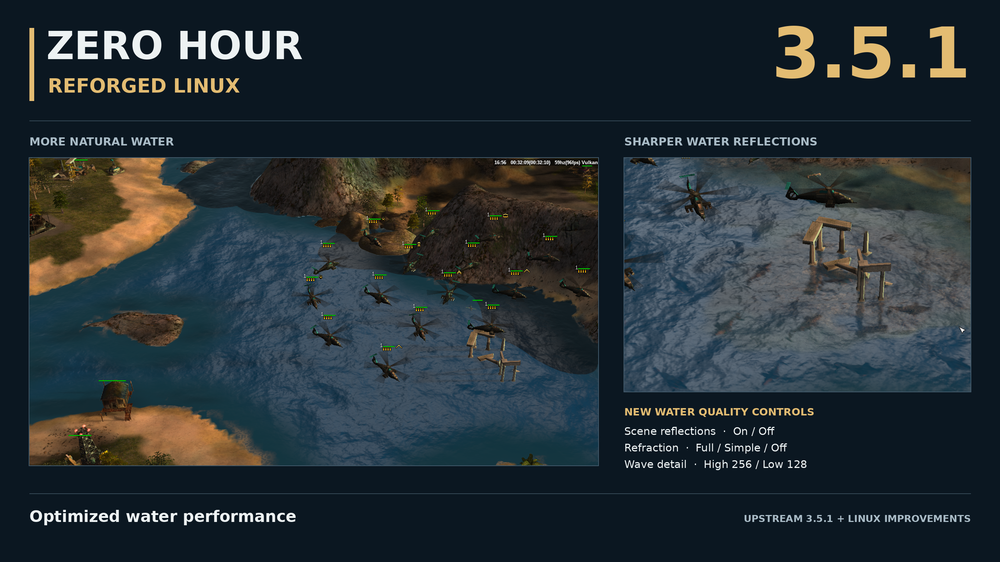
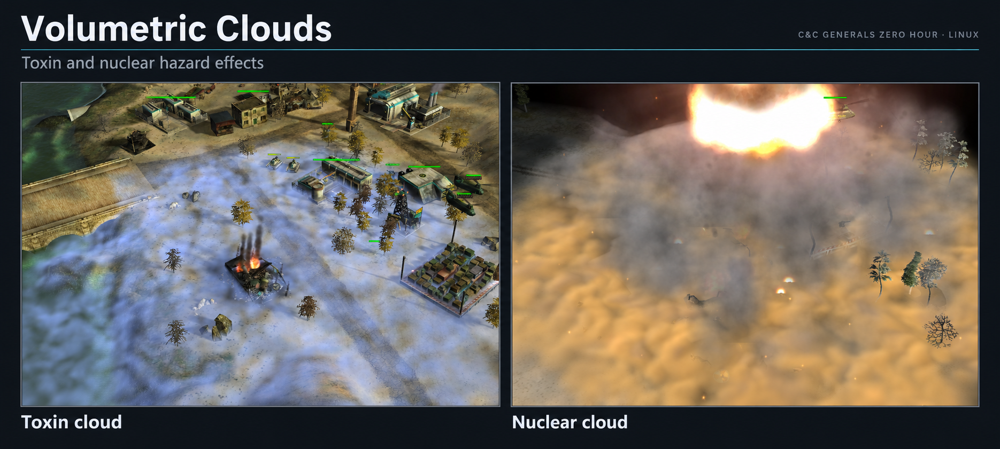
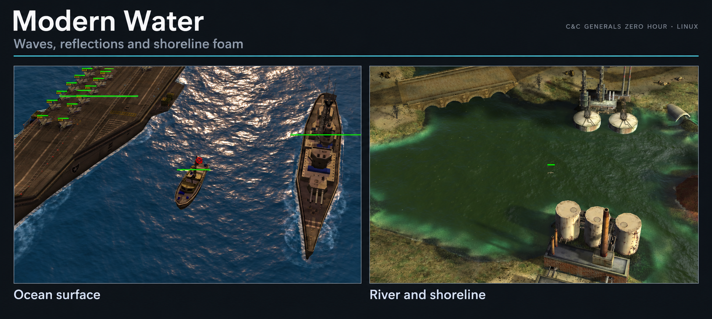
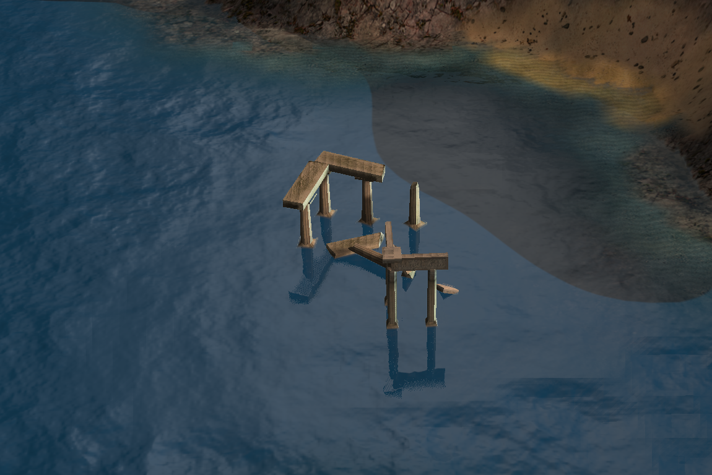
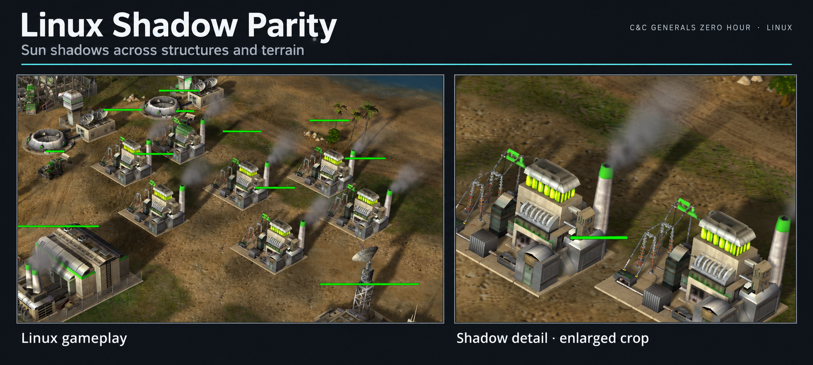

# Zero Hour Reforged Linux

Command & Conquer: Generals Zero Hour for **64-bit Linux**, using **SDL3 and Vulkan**.
No Wine or Proton required.

Based on [Zero Hour Reforged](https://github.com/olcayseygan/CnCGeneralsZH-Reforged) and EA's released
source, synchronized with upstream **v3.5.1**, with Linux graphics improvements and upstream's
gameplay, AI, audio and interface changes. New since this origin's 3.4.2: more natural water,
optimized water performance, water quality controls and sharper path-traced water reflections,
plus upstream's rank perks, leader auras and movement improvements.



[3.5.1 release notes](docs/releases/v3.5.1.md)

[](https://github.com/Shin-Aska/CnCGeneralsZH-Reforged-Linux/commits/main)
[](LICENSE.md)

[Downloads](#downloads) · [Graphics highlights](#graphics-highlights) · [Build](#build) · [Play](#play) · [Tests](#tests) ·
[Linux guide](docs/linux.md) ·
[Changes](CHANGELOG.md) · [Contributing](CONTRIBUTING.md)

**You need your own installed copies of Generals and Zero Hour.**
Game data and optional upscaled art are not included.

## Downloads

Tagged builds publish packages to [GitHub Releases](https://github.com/Shin-Aska/CnCGeneralsZH-Reforged-Linux/releases)
after the build and package checks pass. For a main-branch, pull request or manual build, open the
[Linux workflow](https://github.com/Shin-Aska/CnCGeneralsZH-Reforged-Linux/actions/workflows/linux-release.yml),
select the completed run, and download the `linux-x86_64-packages` artifact. A manual build is available
through **Run workflow** once the workflow is on the default branch; it does not publish a release.

| Format | Intended use |
|:--|:--|
| `.AppImage` | One executable file; make it executable and launch it. Use `--appimage-extract-and-run` if FUSE is unavailable. |
| `ZeroHourReforged-linux-x86_64.tar.zst` | Extract anywhere and run `zero-hour-reforged.sh`; includes a separate debug-symbol file. |
| `.deb` | Debian and Ubuntu package managers. |
| `.rpm` | Fedora and openSUSE package managers. |
| `.pkg.tar.zst` | Arch Linux, installed with `pacman -U`. |
| `.flatpak` | Local Flatpak bundle, installed with `flatpak install --user ./<bundle>.flatpak`; requires the Freedesktop 25.08 runtime. |

Every download set includes `SHA256SUMS`. After downloading all listed files, verify them with:

```sh
sha256sum --check SHA256SUMS
```

The distributed engine targets **x86_64 Linux with glibc 2.31 or newer**. It is built in Valve's Steam
Runtime **sniper** SDK with static libstdc++ and libgcc; native packages also need fontconfig and a
working Vulkan driver. The Flatpak uses its declared runtime and still needs a compatible host graphics
driver. This ABI baseline is separate from the distributions checked by a particular workflow run.
**Ubuntu 22.04 is the minimum Ubuntu release targeted by CI**, with both DEB and AppImage installation
and startup checks plus synthetic renderer tests on Mesa's software Vulkan driver. CI also checks
Debian 12, Ubuntu 24.04, Fedora, openSUSE Tumbleweed and Arch; the
AppImage is additionally checked on Debian 12. These checks do not establish gameplay or
hardware compatibility on every distribution.

Packages contain the engine and this repository's overlay, **no original game data or upscaled art**.
Point the launcher at your own legally obtained Generals and Zero Hour installation. See
[CI and release details](PORTING.md#github-actions-builds-and-releases) for triggers, permissions,
the compatibility checks and testing limits.

## Graphics highlights

New profiles use **Volumetric clouds**, **Modern water** and **mapped sun shadows**.
Existing settings are kept. Change **Cloud style** and **Water style** under **Options → Graphics**.

### Volumetric Clouds

Toxin and nuclear clouds follow the terrain and the hazard's size and lifetime. Nuclear effects
include heat distortion and embers. Damage and gameplay timing stay the same.



[Settings and checks](docs/linux.md#hazard-clouds) · [Cloud preview](docs/cloud-preview.md)

### Modern Water

Modern water adds waves, reflections and foam around boats and shorelines.
It also receives sun and smoke shadows.



[Shoreline waves](docs/linux.md#boundary-aware-water) · [Water preview](docs/water-preview.md)

### Water Reflections

Choose **Legacy**, **SSR**, **Hybrid** or **Path traced (experimental)** under **Options → Effects → Reflections**.
These modes apply to Modern water. Hybrid is the default and combines planar reflections with
screen-space reflections. SSR alone can miss objects hidden from the camera or outside the screen.
Click **Accept** to apply and save the choice.



[Reflection modes and demo controls](docs/water-preview.md#reflections)

### Sun Shadows

Buildings, units and trees cast shadows across terrain, structures and Modern water.



[Supported effects and checks](docs/sdl-sun-shadows.md#default-rendering-rollout-linux-2026-10-16)

## Build

Tested on **Ubuntu 26.04.1 LTS** with **GCC 16** and an **NVIDIA GeForce RTX 4060**.
See the [Linux guide](docs/linux.md) for driver versions and test results.
Windows and macOS code is inherited from upstream; this fork focuses on Linux.

### Ubuntu prerequisites

Install any missing build dependencies:

```sh
sudo apt-get install g++ gcc-16 g++-16 cmake ninja-build git curl unzip xz-utils make pkg-config python3 \
  libx11-dev libxext-dev libxcursor-dev libxi-dev libxfixes-dev libxrandr-dev libxss-dev libxtst-dev \
  libwayland-dev libxkbcommon-dev wayland-protocols libegl-dev libdrm-dev libgbm-dev libvulkan-dev
```

The test suite also uses `unifdef` and `spirv-tools`:

```sh
sudo apt-get install unifdef spirv-tools
```

A working Vulkan driver is required. The build script reports missing packages but does not install them.

### Clone and compile

```sh
git clone https://github.com/Shin-Aska/CnCGeneralsZH-Reforged-Linux.git
cd CnCGeneralsZH-Reforged-Linux
CC=gcc-16 CXX=g++-16 ./build-linux.sh Release
```

The script downloads pinned dependencies and builds the game at
`build-linux/ZeroHourReforged/bin/generals`.

GCC 16 is the tested compiler, not a requirement. Omit `CC` and `CXX` to use your default compiler
for a fresh build. To change compilers later, use a new build directory through `build.local.sh`;
CMake keeps the compiler chosen when the build directory was created.

Other build commands:

```sh
./build-linux.sh Debug              # Debug configuration
./build-linux.sh Release generals   # build only the executable; does not stage it
./build-linux.sh Release test       # build, test, then stage if the tests pass
```

The output folder copies its runtime overlay and can be moved. It still uses your installed game data.
See [packaging](PORTING.md#linux-packages) for the release scripts and compatibility-container builds.

## Play

### Launch the game

After building, run this from the repository folder:

```sh
./build-linux/ZeroHourReforged/bin/generals
```

The game looks for installed game files, including Steam libraries. If prompted, select the
**Zero Hour folder containing `INIZH.big`**, then the original Generals folder if requested.
Generals files can also be in `ZH_Generals/` inside or beside the Zero Hour folder.
The game remembers these locations.

### Start a skirmish

Choose **Solo Play → Skirmish**, pick a map and general, add an AI opponent, then click **Start**.
Campaigns are also under **Solo Play**. Display, sound and controls are in **Options**.

### Launch a prepared development install

If you have prepared a game-data folder at `build-linux/play-root`, select it with:

```sh
./build-linux/ZeroHourReforged/bin/generals -root "$PWD/build-linux/play-root"
```

Fresh clones do not include this folder or the optional local `build-linux/play.sh` helper.
The [Linux guide](docs/linux.md#checks-with-game-data) explains how to prepare it.

### Run from VS Code

Follow the [VS Code setup](docs/linux.md#vs-code-launch-setup) first. These profiles build Release
with GCC 16, use `build-linux/play-root` and save settings under `build-linux/vscode-user`.
Select a profile in **Run and Debug** and press **F5**:

| Profile | Action |
|:--|:--|
| **Zero Hour: Play (no debugger)** | Open the main menu |
| **Zero Hour: AI skirmish (no debugger)** | Watch an AI match for 12,000 frames |
| **Zero Hour: Play (Linux)** | Open the main menu under GDB |
| **Zero Hour: AI skirmish (Linux)** | Watch the AI match under GDB |

The GDB profiles require GDB and the Microsoft C/C++ extension.

To update `~/Games/ZeroHourReforged`, run **Terminal → Run Task → Linux: Publish thin executable**.
It builds and copies a stripped executable with the matching runtime files, and reports a backup
folder for replaced files. It preserves existing upscaled art, unrelated files and saves.
**Zero Hour: Publish and Play (thin executable)** in **Run and Debug** also launches that copy
using the normal player save folder.

To make a release folder, zip and `.tar.zst` with portable settings, run **Terminal → Run Task →
Linux: Make portable release zip (this machine)**, or:

```bash
bash GeneralsMD/Code/Tools/linux-portable.sh --host --zip --no-art --build build-linux/release-build --out build-linux/release/ZeroHourReforged-linux-x86_64
```

The archives are written beside `build-linux/release/ZeroHourReforged-linux-x86_64` with a `.sha256`
file. While the release folder has a `UserData` folder, settings, saves and `Registry.ini` stay in it.
A `--host` build needs the build machine's glibc version or newer; `VERSION` records it. Builds for
older distributions and the Steam Deck use the same script without `--host`, which requires Docker.

### Saves and game files

The game reads the original archives without writing to the install folder.
Settings, saves and replays go to
`$XDG_DATA_HOME/Command and Conquer Generals Zero Hour Data`, or
`~/.local/share/Command and Conquer Generals Zero Hour Data` when `XDG_DATA_HOME` is unset.
`ZH_USER_DATA_DIR` overrides that location.

For automated checks, use separate test data as described in the
[Linux guide](docs/linux.md#checks-with-game-data).

Upscaled art is optional. Put existing `Reforged*.big` archives in `ReforgedArt/` inside the user
data folder to use it; without them the game uses the original textures.

## Tests

Build and stage first, then run the tests separately:

```sh
ctest --test-dir build-linux --output-on-failure
```

Asset-dependent tests skip unless `ZH_GAME_DATA` is configured. See the
[Linux guide](docs/linux.md#checks-with-game-data) for game-data setup and GPU, replay and screenshot checks.

GitHub Actions builds the engine and tests once in the sniper SDK, then runs the available tests with
Lavapipe and Xvfb on a standard CPU runner. The run summary reports skipped tests. Public CI supplies no
game data: replay CRCs, gameplay screenshots, original textures/audio/movies and full multiplayer checks
remain separate local validation. Synthetic renderer tests can run without those assets; they do not
test physical GPUs, Steam Deck Game Mode or the desktop folder chooser. The
[workflow documentation](PORTING.md#github-actions-builds-and-releases) defines the gates; consult the
actual run for its results.

**Known NVIDIA test failure:** `ffref_capture_selfcheck` has a two-pixel reference mismatch on the
tested RTX 4060 setup. It passes on the tested Intel UHD 770. This failure stops
`./build-linux.sh Release test` before staging. [Details](docs/linux.md#remaining-nvidia-comparison-failure).

The recorded checks cover the listed Linux setups. They do not establish cross-platform
multiplayer compatibility or support for untested distributions, GPUs and release packages.

## Contributing and credits

For bug reports, include your distribution, compiler, GPU, driver and relevant logs.
See [CONTRIBUTING.md](CONTRIBUTING.md) for contribution guidelines.

Electronic Arts released the Generals and Zero Hour source in 2025. This fork builds on
[olcayseygan/CnCGeneralsZH-Reforged](https://github.com/olcayseygan/CnCGeneralsZH-Reforged), including
the macOS, Linux and Windows ARM64 port by İlyas Akın (ilyasakin). Work inherited from
[TheSuperHackers/GeneralsGameCode](https://github.com/TheSuperHackers/GeneralsGameCode) remains credited
in its source and commits. [NOTICE.md](NOTICE.md) lists third-party notices and
[LICENSE.md](LICENSE.md) contains GPLv3 and EA's additional terms.
