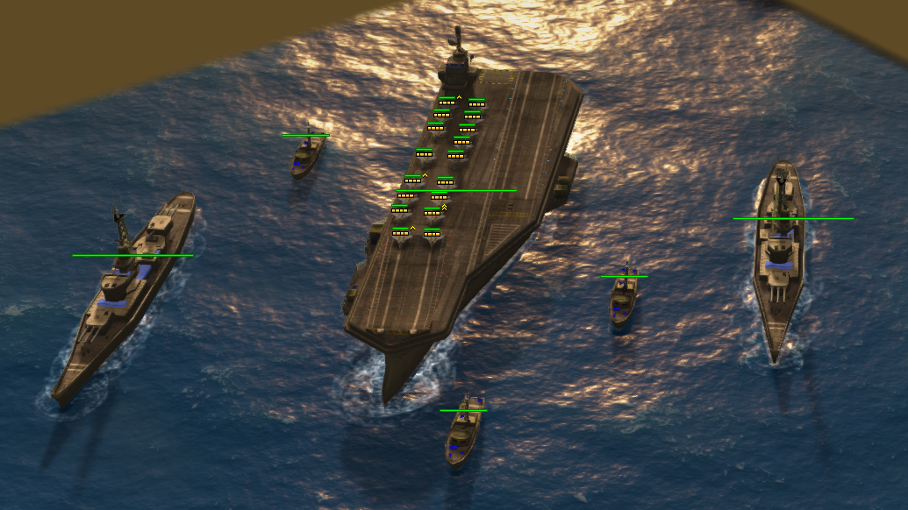

# Zero Hour Reforged Linux

An experimental fork of Zero Hour Reforged that runs Generals and Zero Hour
natively on 64-bit Linux with SDL3 and Vulkan. [Upstream project](https://zerohour.gg) ·
[Upstream source](https://github.com/olcayseygan/CnCGeneralsZH-Reforged)

## Downloads

[Download for Linux](https://github.com/Shin-Aska/CnCGeneralsZH-Reforged-Linux/releases/latest) ·
[v4.3.2 release notes](docs/releases/v4.3.2.md)

Choose an AppImage, portable archive, DEB, RPM, Arch package or Flatpak. Native builds
target x86_64 and require glibc 2.31 or newer and fontconfig. [Package details](PORTING.md#linux-packages)

For development builds, look for `linux-x86_64-packages` in the completed
[Linux workflow runs](https://github.com/Shin-Aska/CnCGeneralsZH-Reforged-Linux/actions/workflows/linux-release.yml).

## Play

You’ll need a working Vulkan driver and your own installed copies of **Generals and Zero Hour**.

1. Launch Reforged. Make the AppImage executable first. For the portable archive, extract it
   and run `./zero-hour-reforged.sh`.
2. If prompted, select the Zero Hour folder containing `INIZH.big`. The launcher may also ask
   for the original Generals folder.
3. Choose **Solo Play** for campaigns or skirmish.

Download optional HD packs from **Options → Graphics → Manage HD Assets**.
[HD asset setup](docs/releases/v4.2.0.md#optional-hd-assets)

## Experimental graphics

Turn off **Options → Graphics → Classic graphics** and restart to use these settings.

- Choose **Modern** under **Water style** for Clean FFT waves that bend along shores, ship foam and optional
  path-traced reflections. [Water settings](docs/linux.md#modern-water-options) · [Reflection modes](docs/linux.md#water-reflections)
- Turn on **Options → Effects → Weather** for rain, snow and blowing sand. Choose **Volumetric** under
  **Cloud style** for volumetric toxin impacts and puddles.
  [Weather settings](docs/linux.md#weather) · [Cloud effects](docs/hazard-clouds.md)
- **Hardware ray tracing** is opt-in on compatible Vulkan GPUs for water reflections
  and some sun shadows. [Ray tracing settings](docs/linux.md#hardware-ray-tracing-and-lighting)



The fork also contributes renderer ports, water improvements and campaign fixes upstream.
[Upstream status](docs/upstream-status.md)

## Build

Install the build dependencies for your distribution before compiling. [Linux build prerequisites](PORTING.md#linux)

```sh
git clone https://github.com/Shin-Aska/CnCGeneralsZH-Reforged-Linux.git
cd CnCGeneralsZH-Reforged-Linux
./build-linux.sh Release
./build-linux/ZeroHourReforged/bin/generals
```

[CLion run configurations](.run/) · [VS Code setup](docs/linux.md#vs-code-launch-setup) ·
[Linux test guide](docs/linux.md#checks-with-game-data)

## Contributing and credits

Include your distribution, GPU, driver and relevant logs in bug reports.
[Contributing guide](CONTRIBUTING.md)

Built on EA’s released source, İlyas Akın’s native port and work from TheSuperHackers.
[GeneralsGameCode](https://github.com/TheSuperHackers/GeneralsGameCode) · [Notices](NOTICE.md) · [License](LICENSE.md)
